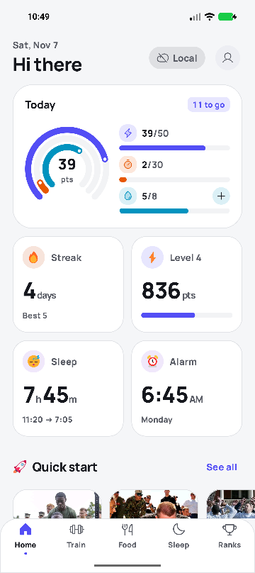
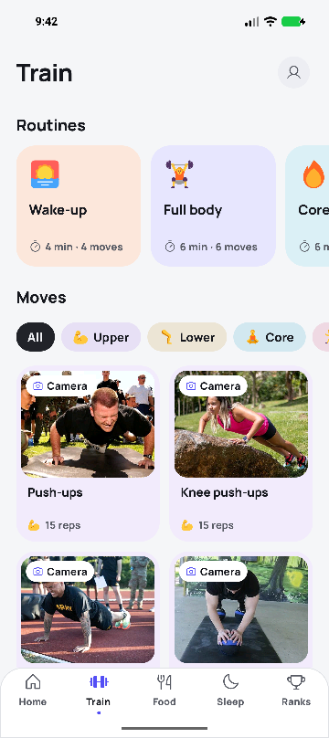
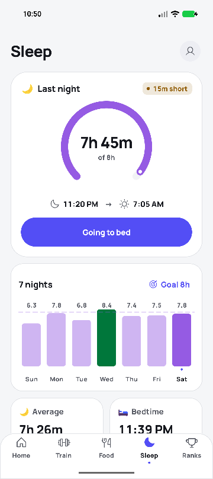
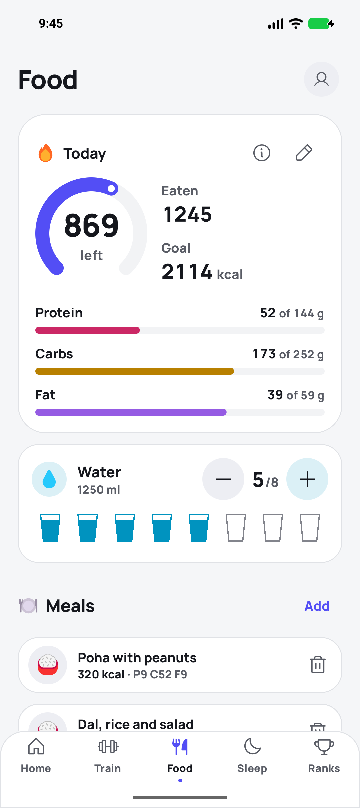
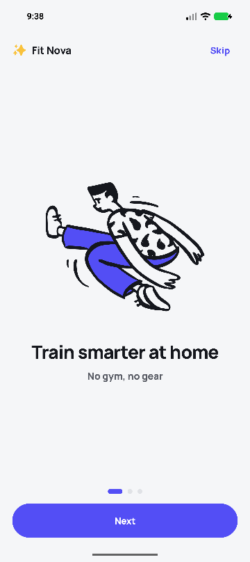
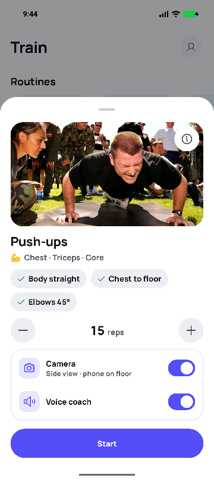
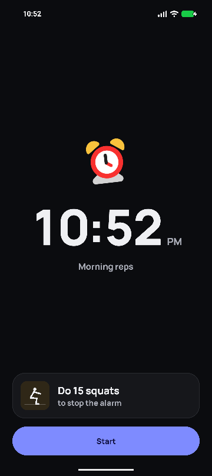
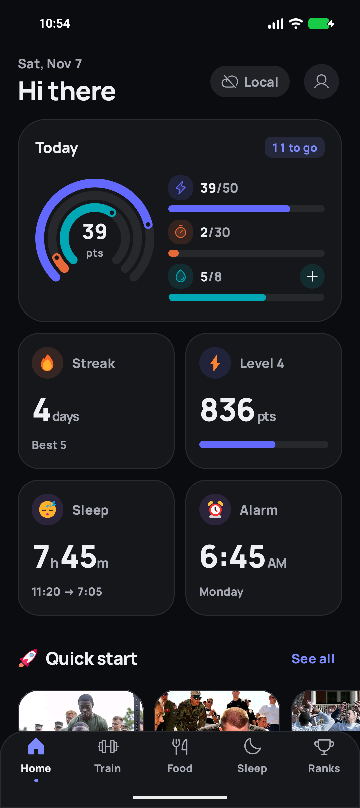

# Fit Nova

A minimal, fast fitness app for Android. It runs well on low-end phones.

<p align="center">
  
  
  
  
</p>
<p align="center">
  
  
  
  
</p>

## Features

- 📷 **Camera form check:** a live skeleton overlay counts reps and checks your posture ("Hips sagging", "Squat deeper"…). Pose detection runs on the phone with ML Kit.
- 🔊 **Voice coach:** counts reps out loud and calls out form fixes, so you never need to look at the screen.
- 🏋️ **27 exercises and 8 guided routines:** Wake-up, Full body, Core crusher, Leg day, Upper push, HIIT cardio, Quiet (no jumps) and Desk break, with rest timers.
- 📊 **Dashboard:** today's points, minutes and water as open rings; streak, level, sleep and next-alarm tiles; weekly and 30-day activity; form trend; exercise mix.
- 🗓️ **History:** a month heatmap, a list of each day's workouts with delete, and personal bests.
- ⏰ **Alarm challenge:** a wake-up alarm you can only switch off by doing the reps on camera. If the camera can't see you, you solve maths sums instead. You get two snoozes at most.
- 😴 **Sleep log:** tap "Going to bed", and the alarm (or "I'm awake") logs the night. You get weekly bars against your goal, your average, bedtime consistency and sleep debt.
- 🥗 **Nutrition:** calorie and macro targets (Mifflin–St Jeor), a meal log with undo, a water tracker, and 36 researched recipes with photos and search.
- 🏆 **Leaderboards:** global, private **groups** (6-character invite codes) and public **clubs**, each with a podium.
- 🏅 **Badges and levels:** 12 achievements plus XP levels, all worked out from your history.
- 🔔 **Daily reminder** at a time you choose. It is skipped if you already trained that day.
- ☁️ **Offline-first:** everything saves on the phone and syncs to Supabase in the background.
- 🌗 **Light and dark themes:** a flat "Nova Indigo" design with the Manrope font, Phosphor icons, Fluent emoji artwork and Open Doodles illustrations.

## Download

Get the latest APK from [Releases](https://github.com/Suraj64x/FitNova/releases/latest):

| File | For |
|---|---|
| `FitNova-1.5-arm64.apk` | Most phones (2017+). Recommended. |
| `FitNova-1.5-armv7.apk` | Older or low-end phones |
| `FitNova-1.5-universal.apk` | Any phone, if unsure (bigger) |

It requires Android 8.0 or newer. Allow "install unknown apps" when prompted. It installs alongside the old Fit Nova app.

For the alarm challenge, allow **Alarms & reminders** and **Notifications** when the Sleep tab asks. On Android 14 and newer, also allow **full-screen alerts**.

## Build

Requirements: Android Studio 2026.2 or newer (JDK 17+), and Android SDK 37.

```bash
./gradlew testDebugUnitTest assembleDebug
```

The build produces one APK per CPU type (arm64-v8a, armeabi-v7a, x86_64) plus a universal APK, in `app/build/outputs/apk/`. Release builds are minified with R8. They ship a baseline profile, so the app starts faster on low-end phones.

## Backend (Supabase)

Accounts use the existing `nova-auth` edge function, so usernames from the old app keep working.

Run both migrations in order:
1. `20261107000000_fitnova_m1.sql`: workouts and the global leaderboard.
2. `20261108000000_fitnova_m2.sql`: groups, clubs and group boards.

They only add new `fn_*` tables and functions and don't touch existing ones. Paste them into the Supabase SQL editor, or run `supabase db push`. Version 1.5 needs no new migration.

## Layout

```
app/src/main/java/app/fitnova/
  domain/   exercises, routines, points, stats, history, sleep, alarms, nutrition (pure Kotlin)
  pose/     posture rules and rep counting (Coach.kt), camera and skeleton overlay
  data/     SQLite store, Supabase API, encrypted session, background sync
  alarm/    alarm scheduling, ring service, ring screen with the challenge, reminders
  ui/       Compose screens, components, charts, voice coach
```

Posture rules, stats, history, routines, sleep and alarm timing are plain Kotlin, covered by JVM unit tests in `app/src/test`.

## Credits

The icons, emoji artwork, illustrations and font are open source; see [docs/ASSET_CREDITS.md](docs/ASSET_CREDITS.md). Photo credits are in [docs/PHOTO_CREDITS.md](docs/PHOTO_CREDITS.md) and [docs/PHOTO_CREDITS_EXERCISES.md](docs/PHOTO_CREDITS_EXERCISES.md). The app also shows the licences under Profile → Open-source licences.
